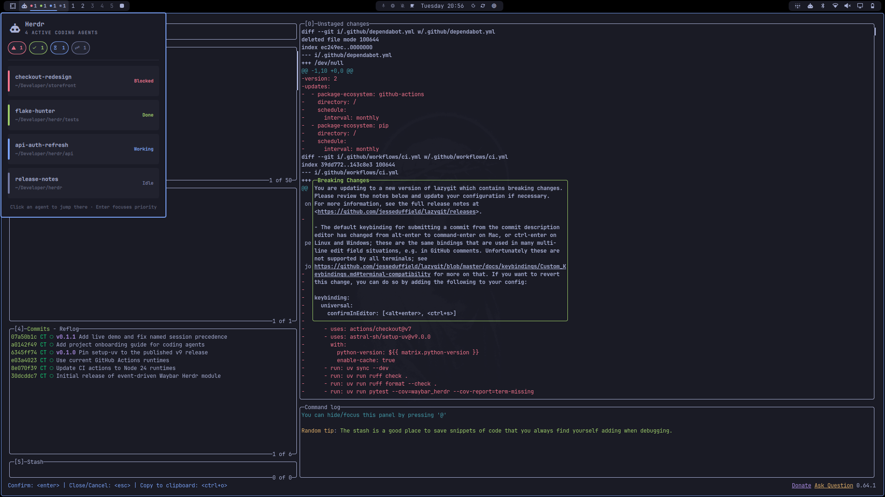

# Herdr for Omarchy

[](https://github.com/carlotran4/omarchy-herdr/actions/workflows/ci.yml)
[](LICENSE)

See every coding agent at a glance. Jump to the one that needs you most.

[](docs/herdr-for-omarchy.mp4)

_Click the preview to watch the 1080p product demo._

A native [Omarchy](https://omarchy.org/) bar plugin for [Herdr](https://herdr.dev/), built with QML and Quickshell. It talks directly to Herdr's Unix socket, updates on events instead of polling, and follows your active Omarchy theme.

## Highlights

- **Live state counters** for blocked, done, working, unknown, and idle agents.
- **One-click priority focus**: blocked first, then done, working, unknown, and idle.
- **Agent dashboard** with names, working directories, and individual jump targets.
- **Event-driven updates** through Herdr's `events.subscribe` API.
- **Native Omarchy design** using the shell's typography, spacing, popup, and theme tokens.
- **Automatic reconnect** after Herdr or the shell restarts.
- **Default, named-session, and explicit-socket support.**
- **No runtime scripts or polling processes**; the widget connects from Quickshell itself.

## Install

Requires Omarchy 4.0+, Quickshell 0.3+, and Herdr 0.8+.

```bash
omarchy plugin add https://github.com/carlotran4/omarchy-herdr --enable
```

The installer validates the manifest, asks where to place the widget, and keeps the Git checkout under `~/.config/omarchy/plugins/carlotran4.herdr/` so it can be updated later:

```bash
omarchy plugin update carlotran4.herdr
```

## Use

| Interaction | Action |
|---|---|
| Left-click | Focus the highest-priority agent |
| Right-click | Open the agent dashboard |
| Middle-click | Refresh now |
| Click an agent | Focus that exact agent |
| Enter in the dashboard | Focus the highest-priority agent |
| Escape | Close the dashboard |

Focusing calls Herdr's `agent.focus`. On Hyprland, the plugin can also raise an existing Herdr window; it never creates a terminal, pane, or agent.

## Configure

Open Omarchy's bar settings and select **Herdr**, or edit its entry in `~/.config/omarchy/shell.json`:

```json
{
  "id": "carlotran4.herdr",
  "session": "work",
  "raiseWindow": true,
  "windowTitle": "herdr"
}
```

Set `socketPath` to override session resolution entirely. Resolution otherwise follows:

- `default` → `~/.config/herdr/herdr.sock`
- a named session → `~/.config/herdr/sessions/<name>/herdr.sock`

## Develop

```bash
omarchy plugin validate .
node --test tests/herdr.test.mjs
qmllint -I /usr/share/omarchy/shell BarWidget.qml HerdrModel.qml
```

For local dogfooding, copy the checkout into the user plugin directory, rescan, and enable it. Never modify `/usr/share/omarchy/`.

## Architecture

`HerdrModel.qml` owns two native `Quickshell.Io.Socket` connections: short request sockets for `agent.list` and `agent.focus`, plus a long-lived event subscription. Events invalidate the snapshot and trigger a fresh normalized `agent.list`, avoiding a second state model inside the plugin. `Herdr.js` contains deterministic priority, formatting, socket resolution, and subscription helpers covered by Node tests.

## Legacy Waybar module

The original Python Waybar implementation remains available in Git history and the `v0.1.1` release. Version 1.0 is the native Omarchy/Quickshell port.

## License

MIT © Carlo Tran
